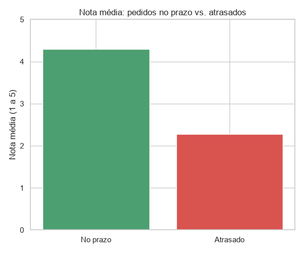
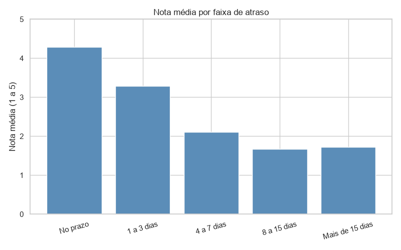

# Análise de Entregas e Satisfação do Cliente (Olist)

## Pergunta de negócio
O atraso na entrega afeta a nota que o cliente dá ao pedido?

## Dados
Base pública da Olist (e-commerce brasileiro), disponível no Kaggle:
"Brazilian E-Commerce Public Dataset by Olist".
Tabelas usadas: pedidos (`orders`) e avaliações (`order_reviews`).

## Limpeza dos dados
- Mantive apenas pedidos com status "entregue", pois os demais não permitem medir atraso.
- Removi 8 pedidos "entregues" sem data de entrega registrada.
- Removi 646 pedidos sem avaliação do cliente.
- Pedidos com mais de uma avaliação: usei a nota média.
- Converti as colunas de data de texto para data.
- Atraso = data de entrega real − data estimada. Valores positivos indicam atraso.
- Base final: 95.824 pedidos.

## Principais descobertas

**1. Pedidos atrasados têm nota média 2 pontos menor.**
Nota média de 2,27 contra 4,29 nos pedidos no prazo. Os atrasos são 6,8% das entregas.
→ Tratar o atraso como prioridade de logística.

**2. Um atraso de 1 a 3 dias já reduz a nota em cerca de 1 ponto.**
→ Avisar o cliente de forma proativa quando o atraso for previsto.

**3. Depois de 8 dias de atraso, a nota se estabiliza perto de 1,7.**
→ Evitar que atrasos curtos virem longos e oferecer compensação nos casos mais graves.

## Gráficos



## Limitações
A análise mostra associação, não causalidade. Outros fatores (qualidade do produto,
atendimento) também influenciam a nota.

## Estrutura do projeto

```
├── dados/
│   └── brutos/          (CSVs da Olist, não incluídos no repositório)
├── relatorios/
│   ├── grafico1_nota_prazo.png
│   └── grafico2_faixa_atraso.png
├── src/
│   └── analise.py
├── requirements.txt
└── README.md
```

## Como executar
1. Baixe a base no Kaggle e coloque os CSVs em `dados/brutos/`.
2. Instale as dependências: `pip install -r requirements.txt`
3. Rode: `python src/analise.py`

## Tecnologias
Python, Pandas, Matplotlib, Seaborn